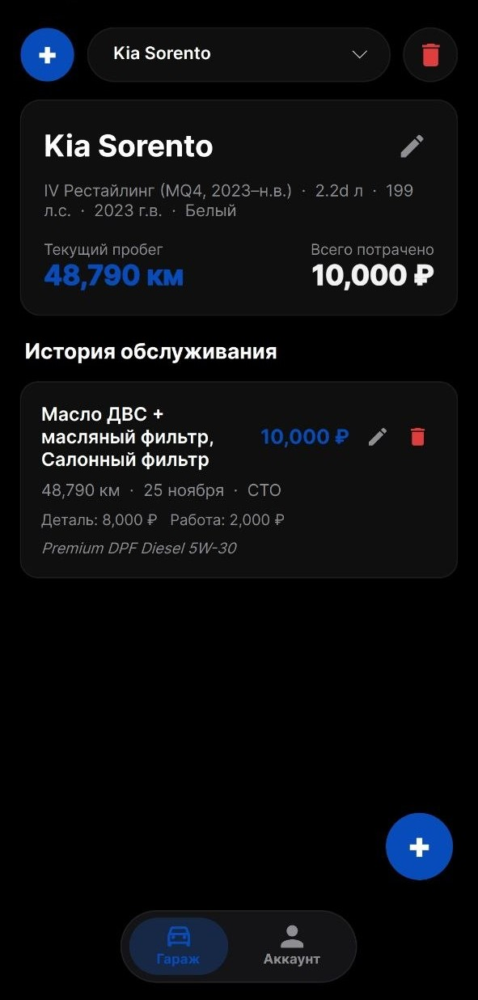
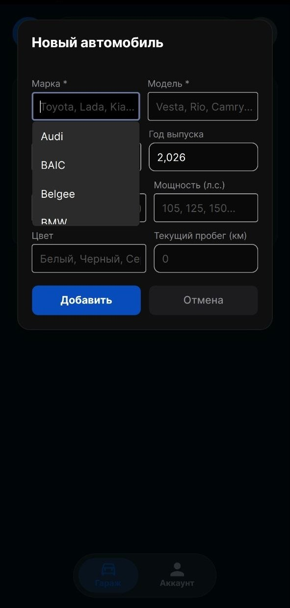
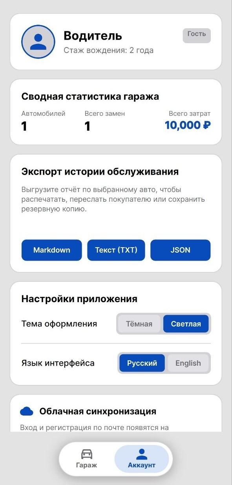
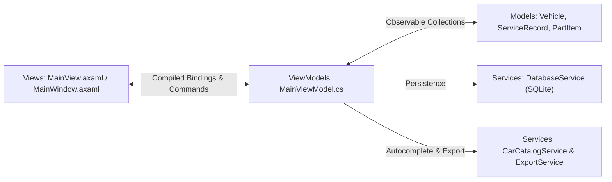

<div align="center">

# 🚗 DriveLog

**Cross-platform mobile and desktop vehicle maintenance logbook and expense tracker.**  
Built with **C#**, **.NET 10**, **Avalonia UI 12**, and **SQLite** following the **MVVM** architecture.

**English** • [Русский](README.ru.md)

[](https://dotnet.microsoft.com/)
[](https://learn.microsoft.com/dotnet/csharp/)
[](https://avaloniaui.net/)
[](#getting-started)
[](https://github.com/si1enzzz/DriveLog/releases/latest)
[](https://codespaces.new/si1enzzz/DriveLog)

</div>

---

## 📸 Screenshots

<div align="center">

| Garage & Multi-Part History (Dark) | Smart Car Catalog (59 Brands) | Account, Export & Settings (Light) |
| :---: | :---: | :---: |
|  |  |  |

</div>

---

## ✨ Key Features

- **🚘 Multi-Vehicle Garage**
  - Store multiple cars with detailed specs: brand, model, generation, year, engine displacement, horsepower, body color, and current mileage.
  - Per-vehicle expense totals (`TotalSpent`) and automatic odometer updates when logging newer maintenance records.
  - Safe deletion dialogs centered on screen to prevent accidental data loss.

- **🔧 Multi-Part Service Records**
  - Log multiple replaced parts with individual prices inside a single service visit (e.g., *Engine oil + Oil filter + Cabin filter*) alongside labor cost, service location, date, and optional notes.
  - Instant search-as-you-type and one-tap dropdown suggestions for common maintenance items.
  - Smart date formatting: displays `25 November` for the current year and includes the year (`15 September 2024`) for older entries.

- **🔍 Smart Car Catalog (59 Brands)**
  - Cascading autocomplete: selecting a brand filters models; selecting a model loads its generations and engine options; selecting a generation auto-fills its starting production year.
  - Includes **homoglyph / keyboard-layout normalization** (typing Cyrillic lookalikes like `к5`, `х5`, `а4` still matches `K5`, `X5`, `A4`).

- **💾 Local SQLite Persistence & Export**
  - All vehicles and service records are persisted locally via `sqlite-net-pcl` (`drivelog.db`).
  - Export complete service history for any vehicle to **Markdown (`.md`)**, **Plain Text (`.txt`)**, or **JSON (`.json`)** for printing, sharing, or backup.

- **🎨 Modern Adaptive UI & Localization**
  - **Dark & Light themes** with automatic OS theme synchronization and live switching in settings.
  - **Bilingual UI (English / Russian)** powered by `AppStrings`.
  - Mobile-friendly UX: keyboard-aware scrollable modals (`AdjustResize`), floating bottom pill navigation, and auto-hiding scrollbars (fade out after 2 seconds of inactivity).

---

## 🏛 Architecture

DriveLog shares a single cross-platform UI and business logic core (`DriveLog`) across Desktop and Android (`DriveLog.Android`) using **MVVM**:



- **Compiled Bindings (`x:DataType`):** All XAML bindings are statically type-checked at compile time.
- **Source Generators (`CommunityToolkit.Mvvm` 8.4):** Reactive properties (`[ObservableProperty]`, `[NotifyPropertyChangedFor]`) and commands (`[RelayCommand]`) with minimal boilerplate.
- **Defensive Catalog Design:** Exposed as `IReadOnlyList<T>` to prevent unintended mutation.

---

## 📁 Project Structure

```text
├── DriveLog/
│   ├── DriveLog/                 # Shared cross-platform UI, ViewModels, Models, Services
│   │   ├── Assets/
│   │   ├── Models/               # Vehicle, ServiceRecord, PartItem
│   │   ├── Services/             # DatabaseService, CarCatalogService, ExportService, AppStrings
│   │   ├── ViewModels/           # MainViewModel, ViewModelBase
│   │   ├── Views/                # MainView.axaml, MainWindow.axaml
│   │   ├── App.axaml
│   │   └── DriveLog.csproj
│   ├── DriveLog.Android/         # Android host project (API 26+)
│   │   ├── Resources/
│   │   ├── AndroidManifest.xml
│   │   ├── Application.cs
│   │   ├── MainActivity.cs
│   │   └── DriveLog.Android.csproj
│   └── DriveLog.slnx             # .NET 10 solution
├── .devcontainer/                # GitHub Codespaces configuration
├── docs/screenshots/             # App screenshots for README
├── README.md                     # Documentation (English)
└── README.ru.md                  # Documentation (Russian)
```

---

## 🚀 Getting Started

### 📥 Download (Android)
Grab the latest signed `.apk` directly from [GitHub Releases](https://github.com/si1enzzz/DriveLog/releases/latest).

### 🛠 Build from Source

#### Prerequisites
- [.NET 10 SDK](https://dotnet.microsoft.com/download)
- Visual Studio 2022/2026, JetBrains Rider, or VS Code with C# Dev Kit
- *(Optional, for Android)* .NET Android workload (`dotnet workload install android`) and Android SDK (API 36)

#### Run on Desktop (Windows / Linux / macOS)
```bash
# Clone the repository
git clone https://github.com/si1enzzz/DriveLog.git
cd DriveLog

# Run the desktop application
dotnet run --project DriveLog/DriveLog/DriveLog.csproj -f net10.0
```

#### Build Android APK (Release)
```bash
dotnet build DriveLog/DriveLog.Android/DriveLog.Android.csproj -c Release -f net10.0-android
```

---

## 🗺 Roadmap

- [ ] Category badges and filtering on the service history list (`Maintenance`, `Repair`, `Tires`, `Tuning`)
- [ ] Search bar across service records and notes
- [ ] Garage analytics (parts vs. labor cost breakdown, average service cost)
- [ ] Optional email account & cloud sync across devices
