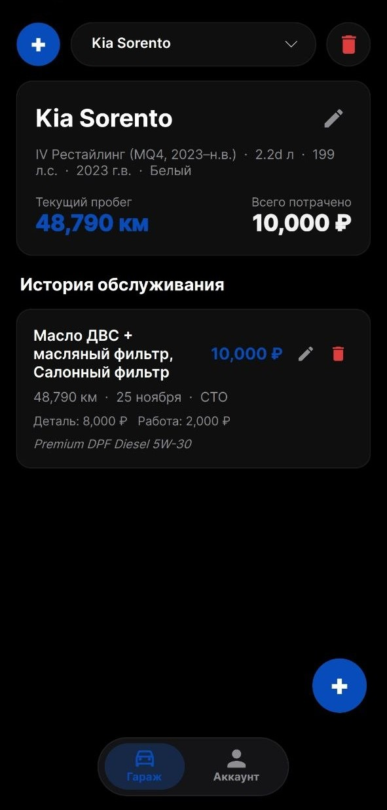
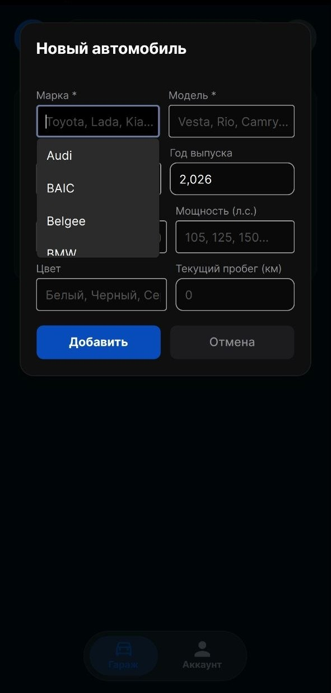
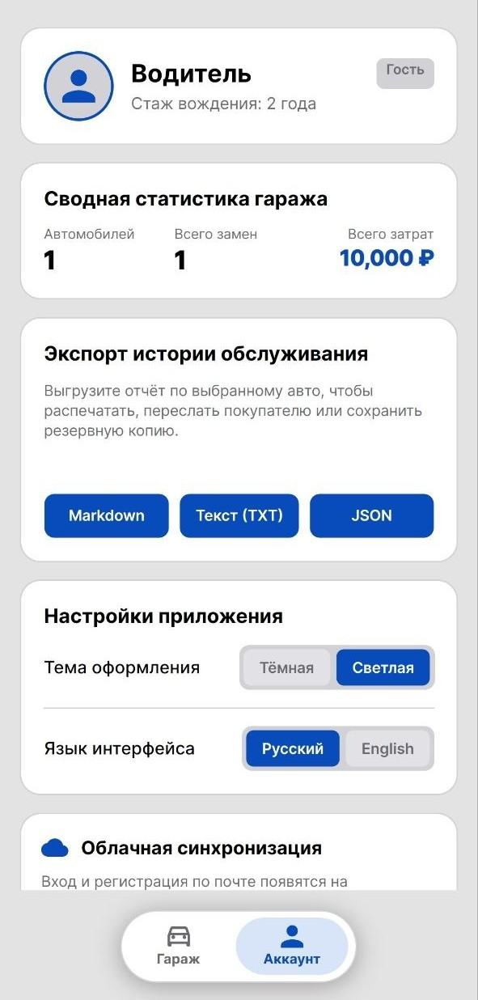
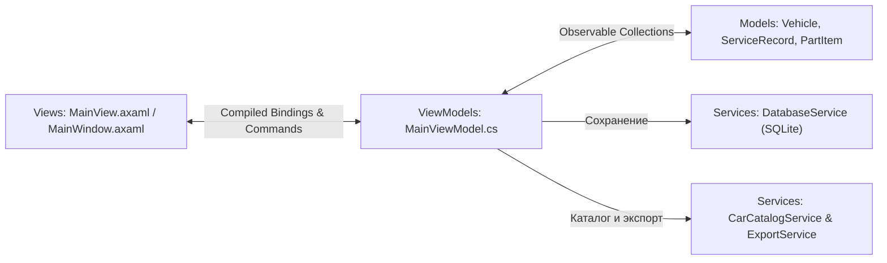

<div align="center">

# 🚗 DriveLog

**Кроссплатформенный мобильный и десктопный бортжурнал для учёта обслуживания автомобилей и контроля расходов.**  
Разработано на **C#**, **.NET 10**, **Avalonia UI 12** и **SQLite** по архитектуре **MVVM**.

[English](README.md) • **Русский**

[](https://dotnet.microsoft.com/)
[](https://learn.microsoft.com/dotnet/csharp/)
[](https://avaloniaui.net/)
[](#запуск-и-сборка)
[](https://github.com/si1enzzz/DriveLog/releases/latest)
[](https://codespaces.new/si1enzzz/DriveLog)

</div>

---

## 📸 Скриншоты

<div align="center">

| Гараж и мульти-записи ТО (Тёмная) | Справочник авто (59 брендов) | Аккаунт, экспорт и настройки (Светлая) |
| :---: | :---: | :---: |
|  |  |  |

</div>

---

## ✨ Ключевые возможности

- **🚘 Мульти-гараж (несколько автомобилей)**
  - Хранение списка автомобилей с детальными характеристиками: марка, модель, поколение, год выпуска, объём двигателя, мощность (л.с.), цвет и текущий пробег.
  - Индивидуальный подсчёт всех затрат (`TotalSpent`) и автоматическое обновление пробега машины при добавлении более свежей записи.
  - Защита от случайного удаления: подтверждающие диалоги по центру экрана для удаления авто, записи и отдельной детали.

- **🔧 Несколько деталей в одной записи ТО**
  - Возможность записать сразу несколько заменённых деталей с отдельной ценой для каждой (например, *Масло ДВС + Масляный фильтр + Салонный фильтр*), общую стоимость работы, место обслуживания, дату и заметку.
  - Выпадающие подсказки популярных работ в одно нажатие.
  - Умное форматирование дат: для текущего года выводится день и месяц (`25 ноября`), а для прошлых лет автоматически добавляется год (`15 сентября 2024 г.`).

- **🔍 Интеллектуальный справочник авто (59 брендов)**
  - Каскадный автокомплит: выбор марки фильтрует модели; выбор модели подгружает поколения и линейку двигателей; выбор поколения автоматически подставляет начальный год выпуска.
  - **Нормализация раскладки (Homoglyph Resolution):** умный поиск распознаёт русские буквы-двойники («к5», «х5», «а4») при вводе с русской клавиатуры.

- **💾 Локальная база SQLite и экспорт отчётов**
  - Надёжное локальное хранение через `sqlite-net-pcl` (`drivelog.db`) — данные сохраняются между перезапусками без интернета.
  - Выгрузка истории обслуживания выбранного авто в **Markdown (`.md`)**, **Текст (`.txt`)** или **JSON (`.json`)**.

- **🎨 Адаптивный интерфейс и локализация**
  - **Тёмная и светлая темы** с автоматической подстройкой под тему устройства и ручным переключением в настройках.
  - **Двуязычный интерфейс (Русский / English)**.
  - Продуманный мобильный UX: прокрутка форм над экранной клавиатурой (`AdjustResize`), нижняя плавающая панель навигации и автоскрытие полосы прокрутки через 2 секунды бездействия.

---

## 🏛 Архитектура

Приложение использует единое кроссплатформенное ядро (`DriveLog`) для Desktop и Android (`DriveLog.Android`) по паттерну **MVVM**:



- **Compiled Bindings (`x:DataType`):** строгая типизация привязок с проверкой на этапе компиляции.
- **Source Generators (`CommunityToolkit.Mvvm` 8.4):** реактивные свойства (`[ObservableProperty]`, `[NotifyPropertyChangedFor]`) и команды (`[RelayCommand]`).
- **Защищённый каталог:** данные каталога отдаются через `IReadOnlyList<T>`, что исключает случайную модификацию извне.

---

## 📁 Структура проекта

```text
├── DriveLog/
│   ├── DriveLog/                 # Общий кроссплатформенный UI, ViewModel, модели и сервисы
│   │   ├── Assets/
│   │   ├── Models/               # Vehicle, ServiceRecord, PartItem
│   │   ├── Services/             # DatabaseService, CarCatalogService, ExportService, AppStrings
│   │   ├── ViewModels/           # MainViewModel, ViewModelBase
│   │   ├── Views/                # MainView.axaml, MainWindow.axaml
│   │   ├── App.axaml
│   │   └── DriveLog.csproj
│   ├── DriveLog.Android/         # Android-проект (API 26+)
│   │   ├── Resources/
│   │   ├── AndroidManifest.xml
│   │   ├── Application.cs
│   │   ├── MainActivity.cs
│   │   └── DriveLog.Android.csproj
│   └── DriveLog.slnx             # Решение .NET 10
├── .devcontainer/                # Конфигурация для GitHub Codespaces
├── docs/screenshots/             # Скриншоты для README
├── README.md                     # Документация (English)
└── README.ru.md                  # Документация (Русский)
```

---

## 🚀 Запуск и сборка

### 📥 Скачать на Android
Готовый `.apk`-файл можно скачать на странице [GitHub Releases](https://github.com/si1enzzz/DriveLog/releases/latest).

### 🛠 Сборка из исходников

#### Требования
- [.NET 10 SDK](https://dotnet.microsoft.com/download)
- Visual Studio 2022/2026, JetBrains Rider или VS Code с C# Dev Kit
- *(Для Android)* workload `android` (`dotnet workload install android`) и Android SDK (API 36)

#### Запуск на ПК (Windows / Linux / macOS)
```bash
# Клонировать репозиторий
git clone https://github.com/si1enzzz/DriveLog.git
cd DriveLog

# Запустить приложение
dotnet run --project DriveLog/DriveLog/DriveLog.csproj -f net10.0
```

#### Сборка APK для Android (Release)
```bash
dotnet build DriveLog/DriveLog.Android/DriveLog.Android.csproj -c Release -f net10.0-android
```

---

## 🗺 Планы развития (Roadmap)

- [ ] Выбор и фильтрация записей по категориям (`ТО`, `Ремонт`, `Шиномонтаж`, `Тюнинг`)
- [ ] Поиск по истории обслуживания и заметкам
- [ ] Расширенная аналитика гаража (детали vs работа, средний чек обслуживания)
- [ ] Регистрация по почте и облачная синхронизация между устройствами
